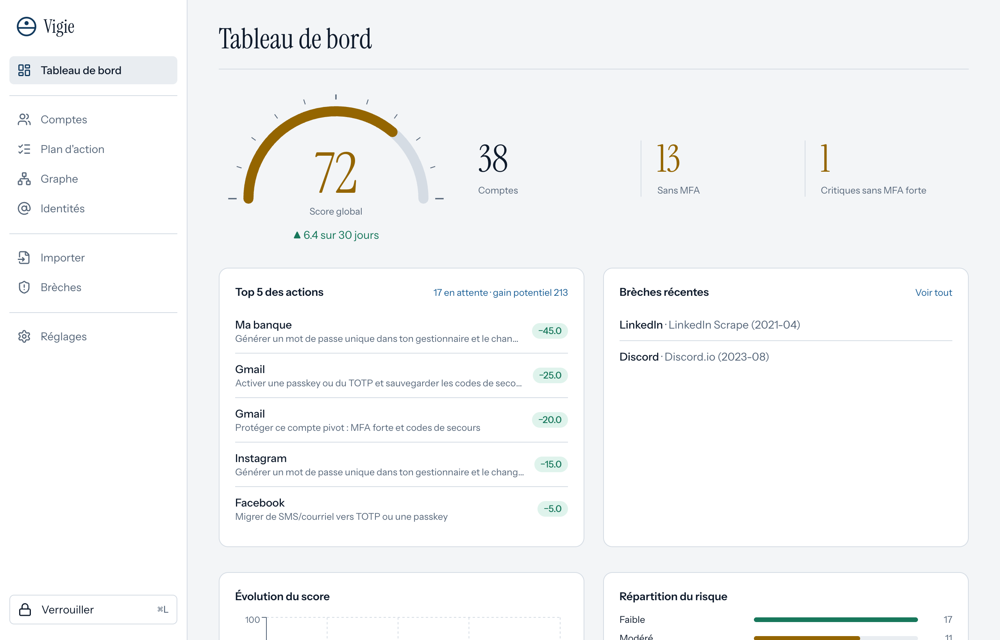
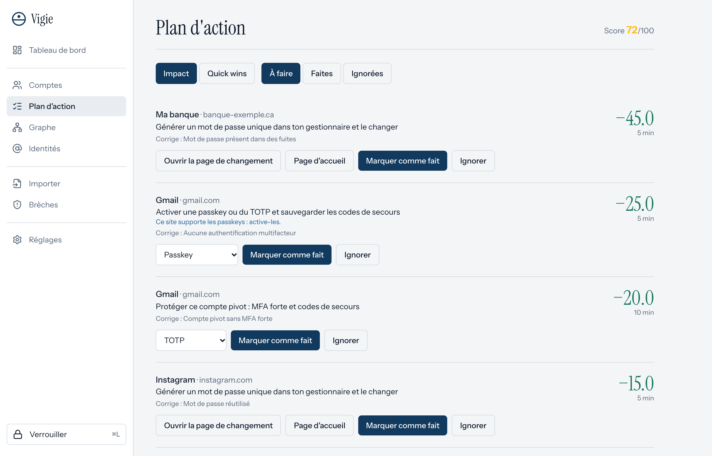
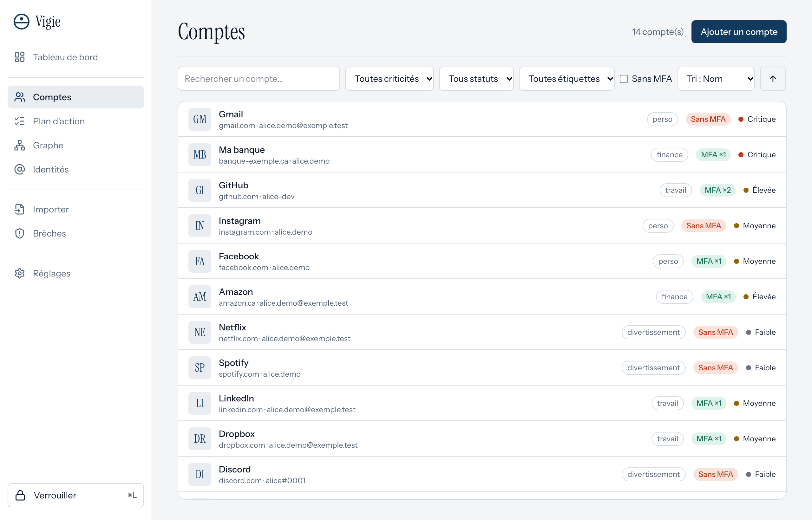
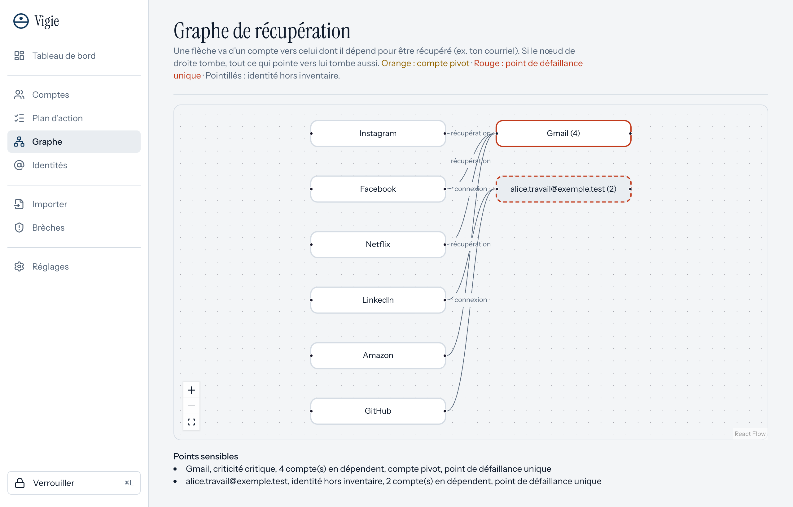
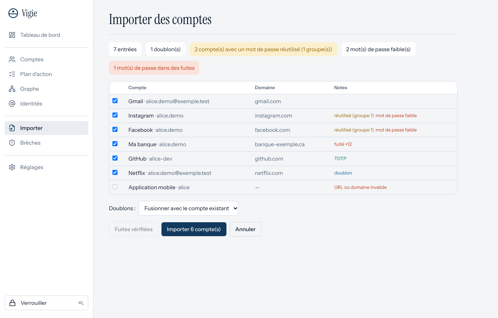
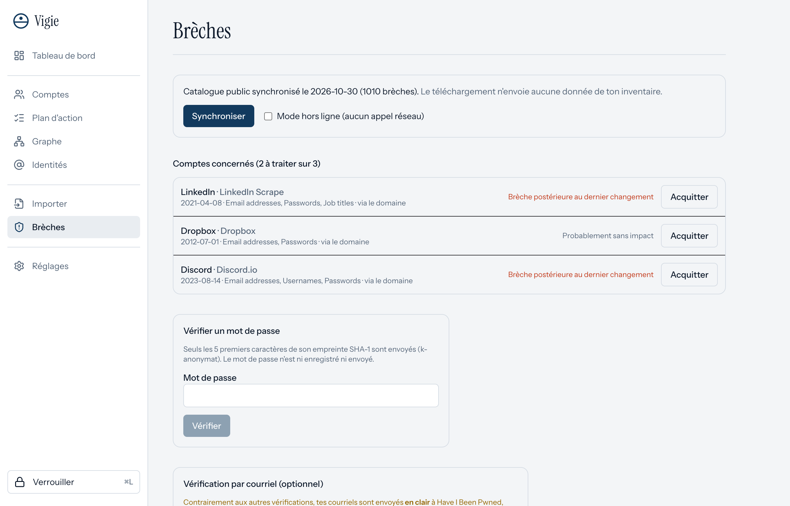
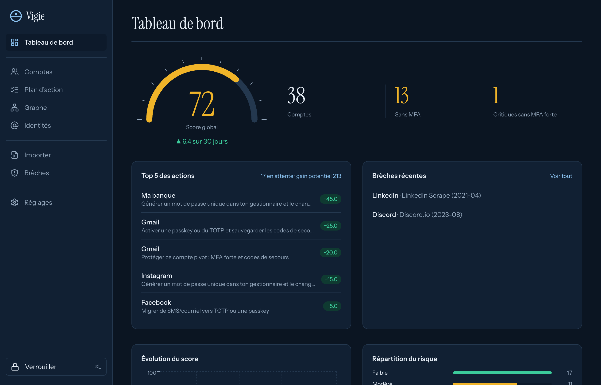

<div align="center">

# Vigie

**Inventaire de sécurité de tes comptes en ligne : local, chiffré, sans cloud.**
Vigie recense tes comptes, détecte les risques et te dit **quoi corriger en premier**.

[](https://github.com/yassineeljal/Vigie/actions/workflows/ci.yml)
[](LICENSE)




</div>

> Les captures de ce README utilisent des **données fictives**.

## Pourquoi Vigie existe

On a des dizaines de comptes et on ne sait pas lesquels n'ont pas de MFA, lesquels réutilisent un mot de passe, lesquels ont subi une brèche, ni quel courriel sert à récupérer tous les autres. Vigie répond à une seule question : **par où commencer ?**

Vigie n'est **pas** un gestionnaire de mots de passe : il ne stocke aucun mot de passe et ne les remplit pas. Il lit un export de ton gestionnaire (ou de ton navigateur), en tire la force et la réutilisation des mots de passe, puis les oublie.

## Fonctionnalités

- **Coffre chiffré** : SQLCipher (AES-256), clé protégée par Argon2id, clé de récupération imprimable, verrouillage automatique
- **Inventaire** : comptes, identités (courriels, téléphones), méthodes MFA, criticité, étiquettes, recherche et filtres
- **Import en quelques secondes** : Chrome, Edge, Brave, Firefox, Bitwarden (CSV/JSON), app Mots de passe d'Apple, ou n'importe quel CSV ; doublons fusionnés, mots de passe réutilisés détectés
- **Renseignement** : mots de passe fuités (Pwned Passwords, par k-anonymat), brèches publiques Have I Been Pwned corrélées par domaine, méthodes MFA par site (2fa.directory)
- **Score explicable** : global et par compte, avec chaque facteur et ses points ; plan d'action trié par **impact** ou par **quick wins**
- **Suivi** : tableau de bord, historique du score, graphe des dépendances de récupération, notifications sans noms de comptes
- **Portabilité** : export JSON/CSV sans secrets, sauvegarde chiffrée, interface en français et en anglais, clair et sombre, navigation au clavier

## Aperçu

| | |
|---|---|
|  **Plan d'action** : chaque action indique son gain, son effort et le facteur qu'elle corrige. |  **Comptes** : recherche, filtres (« critiques sans MFA »), étiquettes. |
|  **Graphe de récupération** : repère les comptes pivots et les points de défaillance uniques. |  **Import** : aperçu avec doublons, réutilisation et fuites avant d'importer. |
|  **Brèches** : celles qui touchent vraiment tes comptes, selon la date de ton dernier changement. |  **Mode sombre** automatique. |

## Installation

### Depuis les sources (macOS)

Prérequis : les outils en ligne de commande Xcode (`xcode-select --install`), [Rust](https://rustup.rs) et Node.js 22+.

```sh
git clone https://github.com/yassineeljal/Vigie.git
cd Vigie
npm install
npm run tauri build -- --bundles app
cp -R src-tauri/target/release/bundle/macos/Vigie.app /Applications/
```

Puis ouvre **Vigie** depuis le Launchpad ou Spotlight (`⌘ Espace`). La première compilation prend quelques minutes.

### Depuis une release

Quand une release est publiée, télécharge le `.dmg`, vérifie son empreinte (`shasum -a 256 -c SHA256SUMS.txt`) et glisse Vigie dans Applications.

L'app n'est **pas signée ni notarisée** (cela exige un compte développeur Apple payant). Si macOS refuse de l'ouvrir : clic droit sur l'app → **Ouvrir**, ou

```sh
xattr -dr com.apple.quarantine /Applications/Vigie.app
```

Tes données sont dans `~/Library/Application Support/ca.vigie.app/` (fichiers `vault.db` et `vault.header.json`, tous deux chiffrés ou ne contenant que des clés enveloppées).

## Utilisation en 3 étapes

1. **Créer le coffre** : choisis une longue phrase de passe, puis imprime ta clé de récupération (affichée une seule fois).
2. **Importer** : exporte tes mots de passe depuis ton navigateur ou ton gestionnaire (Chrome/Edge/Brave : *Paramètres → Mots de passe → Exporter* ; Firefox : `about:logins` → menu → *Exporter*), choisis le fichier dans l'onglet **Importer**, vérifie l'aperçu, importe, puis **supprime le fichier d'export**.
3. **Suivre le plan d'action** : traite les actions de haut en bas ; chaque action faite met le score à jour.

Raccourcis : `⌘L` verrouille, `Alt+1…8` change d'onglet, `Échap` ferme un panneau.

## Confidentialité : ce qui sort de ta machine

| Fonction | Ce qui est envoyé | Quand |
|---|---|---|
| Mot de passe fuité ? ([Pwned Passwords](https://haveibeenpwned.com/API/v3#PwnedPasswords)) | Les **5 premiers caractères** du SHA-1 du mot de passe, avec `Add-Padding` | Seulement quand tu le demandes (vérification ou import) |
| Brèches d'un **service** | **Rien** : téléchargement du catalogue public | Synchronisation quotidienne (désactivable) |
| Méthodes MFA d'un site ([2fa.directory](https://2fa.directory)) | **Rien** : téléchargement du catalogue public | Avec la synchronisation |
| Brèches d'un **courriel** (option) | Le **courriel en clair**, avec **ta** clé API HIBP (payante, stockée dans le Trousseau macOS) | Seulement après confirmation explicite |

Aucune télémétrie, aucune synchronisation dans le nuage, aucun favicon téléchargé. Le **mode hors ligne** coupe tout appel réseau. Les appels ne partent que du cœur Rust, en HTTPS, vers trois hôtes en liste blanche (`api.pwnedpasswords.com`, `haveibeenpwned.com`, `api.2fa.directory`), sans suivre de redirection.

## Modèle de sécurité

- **Chiffrement au repos** : une clé de données aléatoire de 256 bits chiffre la base (SQLCipher). Elle est elle-même enveloppée (ChaCha20-Poly1305) par une clé dérivée de ton mot de passe maître (Argon2id, 256 MiB, ≈ 0,5 s) et par la clé de récupération. Changer de mot de passe ne rechiffre que cette enveloppe. Au verrouillage, la connexion est fermée.
- **Aucun mot de passe persistant** : les mots de passe d'un import sont lus par le cœur Rust (jamais par la WebView), gardés en mémoire (`SecretString`, effacés au drop) puis oubliés. Seuls leur force et un identifiant de groupe de réutilisation sont enregistrés. Aucun journal n'existe en production (vérifié par un test).
- **Interface** : CSP stricte, capacités Tauri minimales, aucun `dangerouslySetInnerHTML` (règle ESLint), chemins de fichiers choisis dans des boîtes de dialogue natives côté Rust.
- **Exports** : les cellules CSV qui pourraient s'exécuter comme formule dans un tableur sont neutralisées ; les notes sont exclues par défaut.
- **Chaîne d'approvisionnement** : `Cargo.lock`/`package-lock.json`, `cargo-deny`, `npm audit`, Dependabot, gitleaks en CI.

Limites et signalement : voir [SECURITY.md](SECURITY.md).

## Développement

```sh
npm install
npm run tauri dev           # app en développement (Rust installé via rustup)
cd src-tauri && cargo test  # ≈ 100 tests Rust
npm test                    # tests de l'interface
```

La CI exécute `cargo fmt`, `clippy -D warnings`, `cargo test`, `cargo deny`, ESLint, `tsc`, Vitest, `npm audit` et gitleaks. Les types TypeScript des commandes (`src/lib/ipc.ts`) sont générés par `cargo test`. Les règles de score sont dans [`src-tauri/scoring/v1.toml`](src-tauri/scoring/v1.toml). Voir [CONTRIBUTING.md](CONTRIBUTING.md).

Pile : [Tauri 2](https://tauri.app), Rust (`rusqlite` + SQLCipher, `argon2`, `chacha20poly1305`, `reqwest` + rustls), React, TypeScript, Vite, Tailwind CSS, TanStack Query.

## Feuille de route

Touch ID, icône dans la barre de menu, rapport HTML/PDF, mises à jour signées, builds Windows et Linux.

## Licence et remerciements

[MIT](LICENSE). Données de brèches et de mots de passe compromis : [Have I Been Pwned](https://haveibeenpwned.com) (Troy Hunt). Méthodes d'authentification : [2fa.directory](https://2fa.directory). Respecte leurs conditions d'utilisation.
